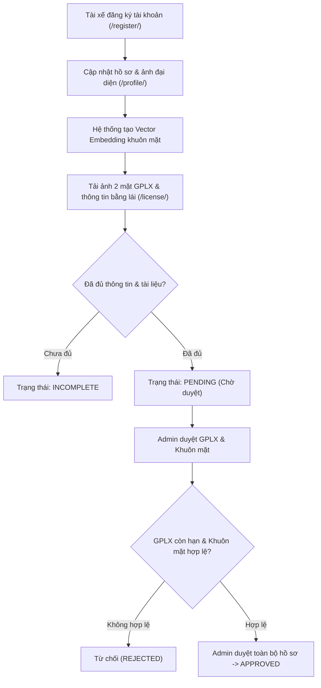
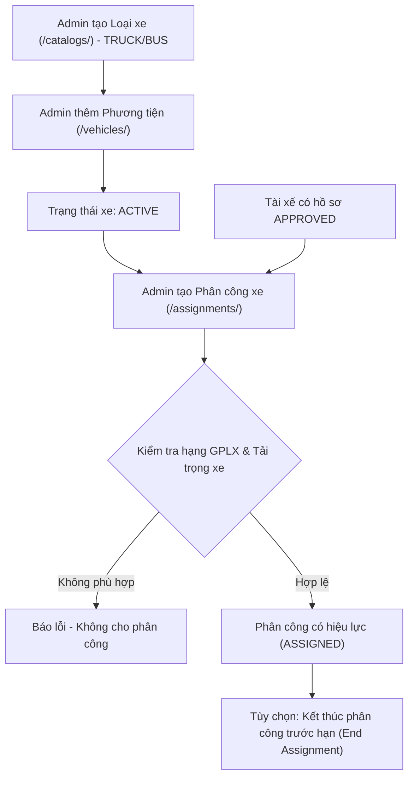
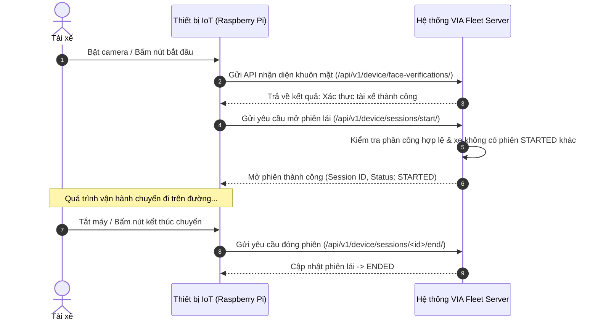
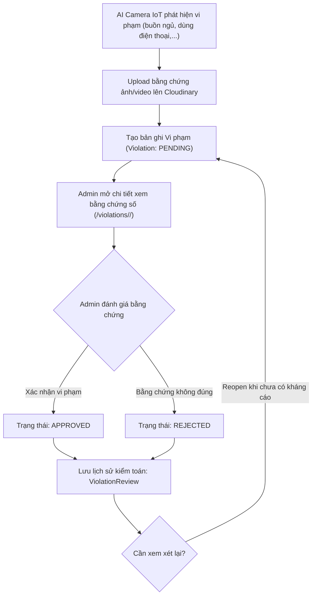

# TÀI LIỆU LUỒNG VÀ NGHIỆP VỤ HỆ THỐNG VIA FLEET

> **VIA Fleet** — Hệ thống quản lý vận tải, phân công đội xe và giám sát an toàn tài xế qua thiết bị IoT Edge / AI.

---

## 1. TỔNG QUAN KIẾN TRÚC VÀ VAI TRÒ HỆ THỐNG

Hệ thống hoạt động theo mô hình tích hợp giữa **Nền tảng Quản trị Web (Django Web Backend)** và **Thiết bị giám sát trên xe (Raspberry Pi / IoT Edge)**.

### Phân quyền người dùng (User Roles)
1. **Quản trị viên (Admin - `role='ADMIN'` hoặc Superuser)**:
   - Quản trị toàn bộ danh mục đội xe, tài xế, thiết bị IoT và loại vi phạm.
   - Thẩm định, phê duyệt hồ sơ tài xế, ảnh khuôn mặt nhận diện và Giấy phép lái xe (GPLX).
   - Lập và quản lý lịch phân công xe cho tài xế.
   - Xem xét bằng chứng số và ra quyết định xử lý vi phạm do AI gửi về.
2. **Tài xế (Driver - `role='USER'`)**:
   - Tự đăng ký tài khoản và cập nhật thông tin cá nhân.
   - Tải lên ảnh khuôn mặt (để trích xuất vector embedding nhận diện khuôn mặt) và ảnh GPLX 2 mặt.
   - Xem thông tin xe được phân công còn hiệu lực.
   - Theo dõi lịch sử các chuyến đi (phiên lái) và các vi phạm của chính mình.

---

## 2. LUỒNG NGHIỆP VỤ HỒ SƠ TÀI XẾ & XÉT DUYỆT (DRIVER ONBOARDING)

### Các quy tắc nghiệp vụ quan trọng:
- **Trạng thái hồ sơ (`DriverProfile`)**:
  - `INCOMPLETE`: Hồ sơ thiếu thông tin cơ bản, thiếu ảnh đại diện hoặc thiếu ảnh/thông tin GPLX.
  - `PENDING`: Hồ sơ đã đủ dữ liệu hoặc có thành phần (GPLX/khuôn mặt) đang chờ Admin xét duyệt. Ưu tiên hiển thị `PENDING` hơn `INCOMPLETE` khi có hạng mục đang chờ duyệt.
  - `APPROVED`: Toàn bộ hồ sơ đã được duyệt; GPLX đã duyệt và còn hạn; ảnh khuôn mặt đã được sinh vector embedding thành công.
  - `REJECTED`: Hồ sơ hoặc tài liệu bị Admin từ chối (yêu cầu tài xế nộp lại).
- **Quy tắc GPLX (`DriverLicense`)**:
  - Phải có đủ 2 mặt ảnh, số GPLX, hệ hạng (B2, C, D, E,...), ngày cấp và ngày hết hạn.
  - GPLX tự động coi là không hợp lệ khi `expiry_date <= ngày hiện tại`.
- **Kiểm soát đồng thời (Optimistic Concurrency)**:
  - Các form cập nhật và thao tác duyệt gửi kèm trường `version`. Nếu dữ liệu đã bị sửa đổi ở phiên khác trước khi lưu, hệ thống sẽ từ chối để tránh ghi đè dữ liệu xung đột.

---

## 3. LUỒNG QUẢN LÝ PHƯƠNG TIỆN & PHÂN CÔNG (VEHICLES & ASSIGNMENTS)

### Quy tắc nghiệp vụ:
- **Phương tiện (`Vehicle`)**: Không xóa cứng để bảo vệ dữ liệu lịch sử chuyến đi; quản lý theo trạng thái vòng đời `ACTIVE` (hoạt động), `INACTIVE` (tạm ngưng), `LIQUIDATED` (thanh lý).
- **Loại xe (`VehicleType`)**: Chỉ được phép xóa khi chưa có bất kỳ phương tiện nào tham chiếu tới loại đó.
- **Phân công (`DriverVehicleAssignment`)**:
  - Chỉ phân công cho tài xế đã được duyệt (`APPROVED`) và xe đang hoạt động (`ACTIVE`).
  - Hạng GPLX của tài xế phải đủ điều kiện điều khiển loại phương tiện (dựa trên nhóm TRUCK/BUS, tải trọng toàn bộ, xe giường nằm theo quy chuẩn GTVT).
  - Khi phân công đã có phiên lái phát sinh, không được phép đổi tài xế, xe hoặc lùi thời gian bắt đầu.
  - Hỗ trợ thao tác **"Kết thúc ngay"**: Đặt thời điểm kết thúc bằng hiện tại để thu hồi xe trước hạn mà không làm mất lịch sử.

---

## 4. LUỒNG PHIÊN LÁI & THIẾT BỊ IOT EDGE (DRIVING SESSIONS & DEVICES)

### Quy tắc nghiệp vụ:
- Mỗi phương tiện gắn tối đa 1 thiết bị IoT còn hoạt động.
- Mỗi xe tại một thời điểm chỉ được phép có **tối đa 1 phiên lái đang diễn ra** (`status='STARTED'`).
- Web quản trị chỉ cung cấp chức năng **xem lịch sử chuyến đi**, không can thiệp khởi tạo/kết thúc phiên thủ công nhằm bảo đảm tính trung thực của dữ liệu từ thiết bị IoT ngoài thực địa.

---

## 5. LUỒNG GIÁM SÁT VI PHẠM & XÉT DUYỆT BẰNG CHỨNG (VIOLATION MONITORING)

### Quy tắc nghiệp vụ:
- **Phát hiện vi phạm**: Thiết bị gửi mã sự kiện, loại vi phạm, mức độ (`LOW`, `MEDIUM`, `HIGH`), thời điểm phát hiện và URL bằng chứng số (HTTPS Cloudinary).
- **Phê duyệt vi phạm**:
  - Chỉ các vi phạm ở trạng thái `PENDING` mới được chỉnh sửa loại vi phạm, mức độ, ghi chú và bấm Xác nhận / Từ chối.
  - Xác nhận bắt buộc phải có ít nhất 1 bằng chứng hợp lệ (`Evidence`).
  - Mỗi quyết định tạo một bản ghi `ViolationReview` lưu người duyệt, thời gian và dữ liệu trước/sau để phục vụ hậu kiểm.
- **Quyền tài xế**: Tài xế chỉ xem được các vi phạm liên quan đến chuyến đi của mình và chỉ xem được khi ở trạng thái `PENDING` hoặc `APPROVED` (không xem được ghi chú nội bộ của quản trị viên).

---

## 6. BẢNG TỔNG HỢP DANH MỤC TRẠNG THÁI HỆ THỐNG

| Đối tượng | Trạng thái | Ý nghĩa nghiệp vụ |
|---|---|---|
| **Hồ sơ tài xế** | `INCOMPLETE` | Thiếu thông tin hoặc thiếu tài liệu (GPLX/ảnh mặt). |
| | `PENDING` | Đã đủ hồ sơ, đang chờ quản trị viên thẩm định. |
| | `APPROVED` | Hồ sơ, bằng lái và khuôn mặt đã được duyệt hợp lệ. |
| | `REJECTED` | Hồ sơ bị từ chối, cần tài xế cập nhật lại. |
| **GPLX** | `PENDING` | Bằng lái mới tạo hoặc mới cập nhật lại, chờ duyệt. |
| | `ACTIVE` | Bằng lái đã được duyệt và đang trong hạn sử dụng. |
| | `EXPIRED` | Bằng lái đã quá ngày hết hạn (`expiry_date <= hôm nay`). |
| | `REJECTED` | Bằng lái bị từ chối do mờ, sai thông tin hoặc nghi ngờ giả mạo. |
| **Phương tiện** | `ACTIVE` | Xe đang hoạt động bình thường, sẵn sàng phân công. |
| | `INACTIVE` | Xe tạm ngưng hoạt động (sửa chữa, bảo trì). |
| | `LIQUIDATED`| Xe đã thanh lý, giữ lại để bảo toàn dữ liệu lịch sử. |
| **Phiên lái** | `STARTED` | Xe đang trong hành trình di chuyển trên đường. |
| | `ENDED` | Chuyến đi đã kết thúc an toàn. |
| **Vi phạm** | `PENDING` | Mới phát hiện từ AI, chờ quản trị viên xem xét bằng chứng. |
| | `APPROVED` | Vi phạm đã được quản trị viên thẩm định và xác nhận. |
| | `REJECTED` | Vi phạm bị từ chối (do nhận diện nhầm, sai bằng chứng). |
| | `REVOKED` | Vi phạm bị thu hồi sau khi xem xét lại hoặc xử lý kháng cáo. |
